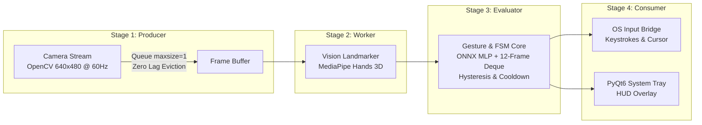

# GestureFlow: Camera-Based OS Gesture Controller

[](https://www.python.org/downloads/)
[](https://developers.google.com/mediapipe)
[](https://onnxruntime.ai/)
[](https://riverbankcomputing.com/software/pyqt/)

> **Multithreaded Hand-Landmark Pipeline, Scale-Invariant Feature Engineering & Low-Latency Input Synthesis.**  
> Built according to Systems & Computer Vision Specification Blueprint v1.2.

---

## ⚡ Key Highlights & Specifications

- **Throughput**: 30–60 FPS camera lock via asynchronous producer-consumer pipeline.
- **End-to-End Latency**: < 45 ms from frame capture to synthetic OS dispatch.
- **63-D Normalized Feature Vector**: Invariant to camera distance, user hand size, and translation.
- **Idle Power Throttling**: Auto-sleep throttles polling from 60 FPS down to 2 FPS when idle for > 5.0 seconds, instantly (< 100 ms) waking upon hand entry.
- **Noise & Recoil Protection**: 4-state Debounce Finite State Machine (`[IDLE] -> [ARMED] -> [TRIGGERED] -> [COOLDOWN]`).
- **"Midas Touch" Mitigation**: Active 60% Region-of-Interest (ROI) bounding box and 400 ms clutch wake pose.
- **Self-Occlusion Defense**: Unit palm surface normal cross-product pauses static pinch evaluation when $|\hat{n}_z| < 0.35$.
- **Precision Pointer**: Speed-adaptive Exponential Moving Average ($\alpha_{\min} = 0.15, \beta = 4.5$) eliminates cursor jitter.

---

## 🏗️ System Architecture



---

## 📂 Repository Layout

```
GestureFlow/
├── config/
│   ├── default_keymaps.json      # Gesture-to-OS action mappings
│   └── settings.yaml             # Core thresholds, timings, camera configs
├── data/
│   ├── landmarks_dataset.csv     # 63-D normalized landmark dataset
│   └── models/
│       ├── hand_landmarker.task  # MediaPipe HandLandmarker Tasks model
│       └── pose_classifier.onnx  # 2-layer ONNX MLP pose classifier
├── src/
│   ├── capture/
│   │   └── camera_stream.py      # Stage 1: Threaded camera producer & sleep throttler
│   ├── vision/
│   │   ├── hand_tracker.py       # Stage 2: MediaPipe 3D landmark extractor
│   │   └── normalizer.py         # Scale/translation invariance & palm normal
│   ├── engine/
│   │   ├── classifier.py         # ONNX runtime pose evaluator
│   │   ├── filters.py            # Adaptive EMA cursor filter & pinch hysteresis
│   │   ├── heuristics.py         # 12-frame deque swipe detector & ROI gate
│   │   └── state_machine.py      # 4-state Debounce FSM
│   ├── os_bridge/
│   │   └── action_dispatcher.py  # Stage 4: Hotkey & mouse synthesis via pynput
│   ├── ui/
│   │   └── hud_overlay.py        # PyQt6 system tray & real-time skeleton HUD
│   └── main.py                   # Master pipeline coordinator
├── tools/
│   ├── recorder.py               # CLI tool to record custom hand poses
│   └── train_classifier.py       # Dataset generator & ONNX exporter
├── tests/                        # Full unit test suite (14 passing tests)
└── requirements.txt
```

---

## 🚀 Quickstart

### 1. Installation

```bash
git clone https://github.com/TharanSK/GestureFlow.git
cd GestureFlow
pip install -r requirements.txt
```

### 2. Launch GestureFlow

```bash
# Standard mode with PyQt6 System Tray and Live Skeleton HUD
python src/main.py

# Headless mode (no GUI overlay, runs strictly in background)
python src/main.py --headless
```

---

## 🎮 Supported Gestures & Default Actions

| Gesture Token | Mechanism | Default OS Action |
| :--- | :--- | :--- |
| **Pinch Down / Drag** | Dual-threshold hysteresis ($\tau_{\text{engage}}=0.22, \tau_{\text{release}}=0.30$) | Left Mouse Click / Click-and-Drag |
| **Precision Pointer** | Speed-adaptive EMA ($\alpha_{\min}=0.15, \beta=4.5$) | Absolute OS Cursor Movement |
| **Swipe Left** | 12-frame circular deque ($\|v\|_2 > 0.35, \cos > 0.85$) | Next Virtual Desktop / Next Slide (`Ctrl + Right`) |
| **Swipe Right** | 12-frame circular deque ($\|v\|_2 > 0.35, \cos > 0.85$) | Previous Virtual Desktop / Prev Slide (`Ctrl + Left`) |
| **Swipe Up** | 12-frame circular deque ($\|v\|_2 > 0.35, \cos > 0.85$) | Volume Up |
| **Swipe Down** | 12-frame circular deque ($\|v\|_2 > 0.35, \cos > 0.85$) | Volume Down |
| **Open Palm (400 ms)**| Debounce FSM Clutch | System Wake / Clutch Activation |
| **Fist** | 2-layer ONNX MLP (Prob $\ge 0.85$) | Play / Pause Media |
| **Peace / V-Sign** | 2-layer ONNX MLP (Prob $\ge 0.85$) | Mute Audio |
| **Thumbs Up** | 2-layer ONNX MLP (Prob $\ge 0.85$) | Snipping Tool Screenshot (`Win + Shift + S`) |
| **OK Sign** | 2-layer ONNX MLP (Prob $\ge 0.85$) | Application Switcher (`Alt + Tab`) |

---

## 🛠️ Recording & Training Custom Poses

To record custom landmark data for personalized poses:

```bash
# Launch interactive CLI recorder (press 1-6 or space for bursts)
python tools/recorder.py

# Retrain and export ONNX model
python tools/train_classifier.py
```

---

## 🧪 Running Automated Tests

```bash
pytest tests/ -v
```
